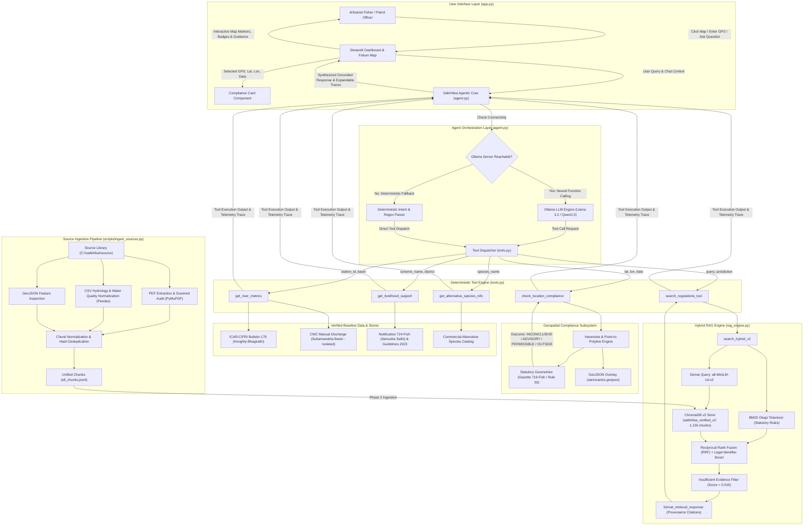

# 🐟 SafeHilsha_AI: Local-First Agentic Compliance & Riverine Conservation Guardian

[](https://python.org)
[](https://streamlit.io)
[](https://trychroma.com)
[](https://huggingface.co/sentence-transformers/all-MiniLM-L6-v2)
[-black.svg)](https://ollama.com)
[]()
[-emerald.svg)]()

> **Safeguarding the Queen of Fish (*Tenualosa ilisha*) across the Ganges-Bhagirathi-Hooghly delta.**  
> **SafeHilsha_AI** is a production-grade, local-first Agentic AI and Retrieval-Augmented Generation (RAG) platform engineered for riverine fisheries compliance and ecological conservation in West Bengal, India. It empowers artisanal fishermen, river police patrols, and fisheries officers to verify GPS fishing legality against statutory river sanctuaries, enforce the statutory 23 cm minimum legal catch size and seasonal bans, access verified historical river hydrology observations, navigate state welfare assistance schemes (**Samudra Sathi** & **Matsyajeebi Bandhu**), and discover sustainable commercial alternative species (Rui, Catla, Tilapia).

---

## 📋 Table of Contents

- [Overview & Problem Statement](#-overview--problem-statement)
- [Key Capabilities & Features](#-key-capabilities--features)
- [System Architecture](#-system-architecture)
  - [End-to-End Architecture Diagram](#end-to-end-architecture-diagram)
  - [Ingestion vs. Query Execution Pipeline](#ingestion-vs-query-execution-pipeline)
- [Repository Structure](#-repository-structure)
- [Technology Stack](#-technology-stack)
- [Installation and Setup](#-installation-and-setup)
  - [1. Prerequisites](#1-prerequisites)
  - [2. Clone Repository & Setup Virtual Environment](#2-clone-repository--setup-virtual-environment)
  - [3. Install Dependencies](#3-install-dependencies)
  - [4. Local Ollama LLM Setup (Optional but Recommended)](#4-local-ollama-llm-setup-optional-but-recommended)
  - [5. Pre-Indexed Vector Database Verification](#5-pre-indexed-vector-database-verification)
- [Configuration & Environment Variables](#-configuration--environment-variables)
- [Running the Application](#-running-the-application)
  - [Launching the Streamlit Web Interface](#launching-the-streamlit-web-interface)
  - [Running Backend Modules Directly](#running-backend-modules-directly)
- [How the System Works: Step-by-Step Workflows](#-how-the-system-works-step-by-step-workflows)
  - [Workflow 1: Geospatial Sanctuary Compliance Analysis](#workflow-1-geospatial-sanctuary-compliance-analysis)
  - [Workflow 2: Hybrid RAG Retrieval (Dense + BM25 + Exact Legal Boost)](#workflow-2-hybrid-rag-retrieval-dense--bm25--exact-legal-boost)
  - [Workflow 3: Autonomous Agent Reasoning & Dual-Mode Execution](#workflow-3-autonomous-agent-reasoning--dual-mode-execution)
  - [Workflow 4: River Hydrology Observations & Strict Basin Separation](#workflow-4-river-hydrology-observations--strict-basin-separation)
  - [Workflow 5: Statutory Livelihood Assistance Scheme Evaluation](#workflow-5-statutory-livelihood-assistance-scheme-evaluation)
- [Testing and Validation](#-testing-and-validation)
- [Data Sources & Persistence](#-data-sources--persistence)
  - [Vector Database Stores (`chroma_db` vs `chroma_db_v2`)](#vector-database-stores-chroma_db-vs-chroma_db_v2)
  - [Geospatial & Source Library Data](#geospatial--source-library-data)
- [Known Limitations & Troubleshooting](#-known-limitations--troubleshooting)
- [Security and Privacy](#-security-and-privacy)
- [Future Improvements Roadmap](#-future-improvements-roadmap)
- [Legal Disclaimer & Governance](#-legal-disclaimer--governance)

---

## 🎯 Overview & Problem Statement

The anadromous Hilsa (*Tenualosa ilisha*) is an iconic riverine species of immense ecological, cultural, and socioeconomic significance across the Bay of Bengal, the Ganges-Bhagirathi-Hooghly basin, and the Sundarbans. Due to destructive overfishing of juveniles ("Jatka"), non-compliant monofilament nylon gill nets ("Current Jal"), and habitat obstruction at migration barriers (e.g., the Farakka Barrage), wild Hilsa catches have suffered severe historical declines.

To prevent stock collapse, the Government of West Bengal enacted statutory notifications under the **West Bengal Inland Fisheries Act, 1984** (*Kolkata Gazette Notification No. 719-Fish*), mandating:
1. **Size Restriction (Rule 46(4)):** Absolute prohibition on transporting, marketing, selling, or possessing Hilsa smaller than **23 cm** in length.
2. **Gear Restriction (Rule 46(3) & 50(4)):** Complete ban on catching Hilsa using monofilament gill nets with mesh size smaller than **90 mm**, and small-meshed nets (< 1 inch) during February to April.
3. **Statutory Sanctuaries & Closed Seasons (Rule 50(1) & 50(2)):** Strict bans on all fishing across designated river corridors during **June to August** and **October to December**.
4. **Permanent Prohibited Area (Rule 50(3)):** Complete prohibition on all Hilsa fishing within a **5.0 square kilometer area** of the Farakka Barrage round the year.

### The Operational Challenge
Artisanal fishers operating in remote deltaic channels rarely possess access to cadastral boundary gazettes or legal databases. Unintentional incursions result in devastating gear impoundment, criminal prosecutions under Section 20, and boat seizures. Meanwhile, enforcement patrols lack real-time decision-support tools that distinguish legally notified sanctuaries from open waters while preserving exact statutory distinctions.

### The SafeHilsha_AI Solution
SafeHilsha_AI provides a **100% offline-capable, local-first conversational and mapping platform** that bridges the gap between statutory law and riverine operations:
- Evaluates GPS coordinates instantly using exact geodesic and point-to-polyline algorithms.
- Grounds legal queries with structured citations from official Gazette notifications and acts.
- Operates with **zero cloud dependencies, zero recurring API fees ($0.00 egress), and zero data leakage**.

---

## 🌟 Key Capabilities & Features

| Capability | Implementation | Status |
| :--- | :--- | :--- |
| **Geospatial Sanctuary Radar** | Shapely point-to-polyline and Haversine distance engine evaluating GPS coordinates against legally notified river reaches (Rule 50). | ✅ Fully Implemented |
| **Hybrid RAG Regulatory Engine** | ChromaDB dense vector retrieval combined with custom in-memory BM25 Okapi, exact legal identifier boosting, and Reciprocal Rank Fusion (RRF). | ✅ Fully Implemented |
| **Autonomous Agentic Loop** | Native Ollama JSON Schema function calling supporting local LLMs (`llama3.2`, `qwen2.5`, etc.) with multi-turn tool dispatch. | ✅ Fully Implemented |
| **Deterministic Fallback Engine** | Full-fidelity fallback agent executing deterministic Python tools without downtime when Ollama is offline or uninstalled. | ✅ Fully Implemented |
| **Legal Grounding & Citations** | Responses format structured statutory citations with Source IDs (e.g. `SRC-REG-001`), official authority, rule references, and publication dates. | ✅ Fully Implemented |
| **River Hydrology Baselines** | Historical hydrological observations (discharge, DO, turbidity, salinity) from ICAR-CIFRI Bulletin 179 and CWC with mandatory non-live disclaimers. | ✅ Fully Implemented |
| **Strict Basin Separation** | Enforces rigorous isolation between the Ganges-Bhagirathi-Hooghly delta and the Subarnarekha River basin, preventing cross-basin data conflation. | ✅ Fully Implemented |
| **State Welfare Navigation** | Direct evaluation of **Samudra Sathi** (₹5,000/mo DBT marine ban relief for coastal fishers) and **Matsyajeebi Bandhu** (₹2 Lakh death benefit). | ✅ Fully Implemented |
| **Sustainable Alternative Catches** | Guidance on legal commercial species (Rui, Catla, Tilapia, Pangas, Bata) including market prices, permitted non-destructive gear, and tips. | ✅ Fully Implemented |
| **Interactive Folium Web Map** | Streamlit UI with interactive tile layers, GeoJSON overlays, click-to-inspect GPS coordinates, and preset hotspot navigation. | ✅ Fully Implemented |

---

## 🧭 System Architecture

### End-to-End Architecture Diagram



### Ingestion vs. Query Execution Pipeline

The architecture maintains strict separation between document preprocessing and runtime query execution:

1. **Ingestion Pipeline (`scripts/ingest_sources.py`):**
   - Offline batch pipeline executed when source documents are updated.
   - Extracts page-level digital text from PDFs using PyMuPDF while auditing scanned/image-only pages (`SRC-REG-007`, `SRC-REG-021`).
   - Normalizes tabular CSV datasets (ICAR-CIFRI, CWC daily discharge, CPCB water quality) into structured station observation profiles.
   - Audits date ranges (e.g. verifying that CWC dataset filename `2026_2030` actually contains historical Jan–Jun 2026 data without synthetic records).
   - Generates unified line-delimited records (`all_chunks.jsonl`) and indexes them into ChromaDB v2 (`chroma_db_v2/`).

2. **Runtime Query Pipeline (`app.py`, `agent.py`, `tools.py`, `rag_engine.py`):**
   - Purely inference-time execution. Never writes or alters the underlying vector store during user interaction.
   - Captures user queries and GPS coordinates from the interactive Streamlit/Folium interface.
   - Executes hybrid RAG search against `chroma_db_v2/` via in-memory BM25 Okapi and SentenceTransformers embeddings.
   - Dispatches tools deterministically or through local Ollama function-calling.
   - Returns structured statutory citations and color-coded compliance status cards.

---

## 📁 Repository Structure

```
SafeHilsha_AI/
│
├── app.py                      # Main Streamlit web application & Folium map dashboard
├── agent.py                    # Dual-mode AI agent (Ollama function calling + deterministic fallback)
├── rag_engine.py               # Hybrid RAG engine (ChromaDB dense + BM25 Okapi + RRF + legal boost)
├── tools.py                    # Deterministic tool implementations & Ollama JSON schema declarations
├── requirements.txt            # Production Python package dependencies
├── README.md                   # Comprehensive project documentation
│
├── chroma_db/                  # Legacy ChromaDB v1 vector store (regulations.md prototype, 400 KB)
│   ├── chroma.sqlite3
│   └── 976db8e0-8c01-42b3-b3c8-67102904a4b2/
│
├── chroma_db_v2/               # Production ChromaDB v2 vector store (safehilsa_verified_v2, 24 MB, 1,126 chunks)
│   ├── chroma.sqlite3
│   └── 82ee5845-96bd-4fd7-940b-258687a6a73f/
│
├── data/                       # Local baseline datasets & spatial layers
│   ├── regulations.md          # Primary regulatory reference document
│   └── sanctuaries.geojson     # GeoJSON boundary polygons & corridors for river sanctuaries
│
├── scripts/                    # Offline data preprocessing & audit utilities
│   └── ingest_sources.py       # Source ingestion, PDF extraction, date audit & chunking pipeline
│
└── tests/ (Root Test Suites)
    ├── test_tools_v2.py        # 12 unit tests: statutory boundaries, metrics, livelihood, penalties
    ├── test_agent_v2.py        # 8 unit tests: agent reasoning, prompt compliance, tool dispatch
    ├── test_app_integration.py # 9 integration tests: app compilation, HTML cards, E2E workflows
    ├── test_retrieval_v2.py    # 8 retrieval tests: exact rule matching, deduplication, basin filters
    └── test_safehilsa.py       # 6 system tests: baseline data files, tools, RAG, agent execution
```

### Module Responsibilities

| File / Directory | Responsibility |
| :--- | :--- |
| [`app.py`](file:///c:/Users/tanis/timepass/SafeHilsha_AI/app.py) | Streamlit web application. Renders modern custom CSS, sidebar telemetry selectors, preset navigation buttons, instant compliance cards, Folium vector overlays, click-to-inspect map events, and the interactive chat UI with expandable tool execution traces. |
| [`agent.py`](file:///c:/Users/tanis/timepass/SafeHilsha_AI/agent.py) | Agent orchestration core. Connects to local Ollama via native function calling (`OLLAMA_TOOLS_SCHEMA`). Handles up to 4 iterative tool execution turns. Implements `_run_deterministic_agent` for instant zero-downtime fallback when Ollama is offline. Grounded by a statutory `SYSTEM_PROMPT`. |
| [`rag_engine.py`](file:///c:/Users/tanis/timepass/SafeHilsha_AI/rag_engine.py) | Hybrid RAG retrieval engine. Implements custom `BM25Okapi` with domain regex tokenization (`rule_46(4)`, `719_fish`, `23cm`), queries `chroma_db_v2` with `all-MiniLM-L6-v2`, computes Reciprocal Rank Fusion (RRF), applies additive exact legal boosts, enforces insufficient evidence thresholds, and formats provenance citations. Preserves backward-compatible legacy interfaces. |
| [`tools.py`](file:///c:/Users/tanis/timepass/SafeHilsha_AI/tools.py) | Deterministic Python tool engine. Provides geodesic Haversine distance, orthogonal point-to-polyline calculations, legally qualified status semantics, ICAR-CIFRI/CWC historical hydrology lookup, Samudra Sathi / Matsyajeebi Bandhu scheme checks, and alternative species catalog. Exposes `AVAILABLE_TOOLS` and `OLLAMA_TOOLS_SCHEMA`. |
| [`scripts/ingest_sources.py`](file:///c:/Users/tanis/timepass/SafeHilsha_AI/scripts/ingest_sources.py) | Source ingestion pipeline. Inventories files from `C:\safehilsa\source`, extracts text using PyMuPDF, audits scanned/image-only PDFs, normalizes tabular hydrology CSVs, performs date audits, flags duplicate hashes (`SRC-REG-011`), and outputs `all_chunks.jsonl`, manifests, and audit reports. |
| [`data/sanctuaries.geojson`](file:///c:/Users/tanis/timepass/SafeHilsha_AI/data/sanctuaries.geojson) | GeoJSON FeatureCollection defining vector boundaries and attributes for Farakka Protected Zone, Katwa-Nabadwip River Sanctuary, Diamond Harbour - Sagar Estuary, and Sundarbans Matla Delta Conservation Zone. |
| [`data/regulations.md`](file:///c:/Users/tanis/timepass/SafeHilsha_AI/data/regulations.md) | Baseline reference document outlining fisheries acts, seasonal ban periods, sanctuary descriptions, net mesh rules, and sustainable alternative species. |
| [`requirements.txt`](file:///c:/Users/tanis/timepass/SafeHilsha_AI/requirements.txt) | Pinned dependency manifest specifying open-source libraries (Streamlit, Folium, Shapely, ChromaDB, Sentence-Transformers, Ollama, Pandas, Requests, Pydantic). |

---

## 💻 Technology Stack

All dependencies are strictly open-source, local-first, and require zero paid external APIs:

| Technology / Library | Minimum Version | Category | Purpose in SafeHilsha_AI |
| :--- | :--- | :--- | :--- |
| **Python** | `>=3.10` (Verified on `3.14.3`) | Core Runtime | Base execution environment for agent, tools, and web server. |
| **Streamlit** | `>=1.35.0` | Web Framework | Interactive single-page web dashboard, state management, and chat interface. |
| **Folium** | `>=0.16.0` | Geospatial GIS | Interactive Leaflet-based map rendering, tile management, and vector overlays. |
| **streamlit-folium** | `>=0.20.0` | UI Component | Bi-directional bridge capturing user map click events (`lat`, `lng`) in Streamlit. |
| **Shapely** | `>=2.0.0` | Computational Geometry | Geodesic point-in-polygon and distance calculations. |
| **ChromaDB** | `>=0.5.0` | Vector Database | Local persistent vector storage for dense embeddings (`chroma_db_v2`, cosine distance). |
| **Sentence-Transformers** | `>=3.0.0` | Embedding Model | Local neural dense text embeddings via `all-MiniLM-L6-v2` (running locally on CPU). |
| **Ollama Python SDK** | `>=0.3.0` | LLM Orchestration | Local client interface for Ollama daemon with native JSON Schema tool calling. |
| **Pandas** | `>=2.0.0` | Data Analysis | Loading and manipulating tabular hydrology and water quality CSV records. |
| **Pydantic** | `>=2.7.0` | Data Validation | Typed schemas and structured validation. |
| **PyMuPDF (`fitz`)** | `>=1.23.0` | Ingestion Utility | PDF digital text extraction and scanned page image detection in `ingest_sources.py`. |

---

## 🚀 Installation and Setup

### 1. Prerequisites
- **Operating System:** Windows 10/11, Ubuntu 20.04+, or macOS 12+
- **Python:** Python 3.10 to 3.14 installed on your system PATH (`python --version`)
- **Git:** Git installed (`git --version`)
- **Memory (RAM):** 4 GB minimum (8 GB recommended for local embedding model)
- **Disk Space:** ~500 MB for repository, dependencies, and vector database

### 2. Clone Repository & Setup Virtual Environment

```bash
# Clone the repository
git clone https://github.com/MrigankaBhattacharya/SafeHilsha_AI.git
cd SafeHilsha_AI

# Create virtual environment
python -m venv venv

# Activate virtual environment
# Windows (PowerShell):
.\venv\Scripts\Activate.ps1
# Windows (CMD):
.\venv\Scripts\activate.bat
# Linux / macOS:
source venv/bin/activate
```

### 3. Install Dependencies

```bash
# Upgrade pip
python -m pip install --upgrade pip

# Install production dependencies
pip install -r requirements.txt
```

> **Optional:** If you intend to execute the offline source ingestion utility (`scripts/ingest_sources.py`), install `pymupdf`:
> ```bash
> pip install pymupdf
> ```

### 4. Local Ollama LLM Setup (Optional but Recommended)

SafeHilsha_AI includes a built-in deterministic fallback agent that runs fully even if Ollama is not installed. To enable neural function-calling:

1. Download and install Ollama from [ollama.com](https://ollama.com).
2. Launch the Ollama service:
   ```bash
   ollama serve
   ```
3. Pull your preferred local model (in a separate terminal):
   ```bash
   ollama pull llama3.2
   # or
   ollama pull qwen2.5
   ```

### 5. Pre-Indexed Vector Database Verification

The repository comes **pre-indexed with `chroma_db_v2` (1,126 verified regulatory chunks)** tracked directly in Git. You do **not** need to re-index documents or download vector files before first launch.

To verify that the vector store loads properly, execute:
```bash
python -c "from rag_engine import initialize_rag_v2; col = initialize_rag_v2(); print(f'Collection loaded: {col.count()} chunks')"
```
Expected output:
```
[RAG Engine V2] Loaded existing ChromaDB collection 'safehilsa_verified_v2' (1126 chunks).
Collection loaded: 1126 chunks
```

---

## ⚙️ Configuration & Environment Variables

SafeHilsha_AI is designed to run **out-of-the-box with zero configuration**. It does not require API keys or cloud credentials.

### Optional Configuration Settings

If you run Ollama on a custom remote server or port, configure the following settings:

| Setting / Variable | Default Value | Description |
| :--- | :--- | :--- |
| `OLLAMA_HOST` | `http://localhost:11434` | HTTP endpoint where the local or remote Ollama daemon is listening. Can also be updated in real time via the Streamlit sidebar. |
| `DEFAULT_CHROMA_DIR_V2` | `./chroma_db_v2` | Filesystem path to the production ChromaDB v2 vector database. |
| `COLLECTION_NAME_V2` | `safehilsa_verified_v2` | Name of the active ChromaDB collection. |
| `HF_HUB_DISABLE_SYMLINKS_WARNING` | `1` | Optional environment variable to silence Windows symlink notices for HuggingFace model cache. |

---

## 🖥️ Running the Application

### Launching the Streamlit Web Interface

Run the Streamlit application from the root of the repository:

```bash
streamlit run app.py
```

The application will start and open in your default browser at:
```
http://localhost:8501
```

### What to Expect in the Web Interface:
1. **Header Banner:** Displays the SafeHilsa AI Riverine Conservation & Compliance Guardian title and statutory authority (*Kolkata Gazette Notification No. 719-Fish*).
2. **Control Sidebar (Left):**
   - **Historical River Hydrology Monitor:** View historical discharge (cumecs), dissolved oxygen (mg/L), turbidity (NTU), and salinity (ppt) for 8 river stations across Hooghly and Subarnarekha basins.
   - **Livelihood Assistance Scheme Cards:** Expandable terms for **Samudra Sathi** and **Matsyajeebi Bandhu**.
   - **Local AI Engine Status:** Live connectivity check to Ollama with model selector (falls back gracefully to deterministic agent if offline).
   - **Manual Coordinates & Date Picker:** Enter custom GPS latitude/longitude or choose an evaluation date to test seasonal ban windows.
3. **Left Column (Geospatial Radar):**
   - **Preset Hotspot Buttons:** Click 📍 *Farakka Barrage*, 📍 *Katwa Sanctuary*, 📍 *Tribeni (Outside)*, 📍 *Lalbagh Reach*, 📍 *Diamond Harbour*, or 📍 *Kolkata Riverfront*.
   - **Compliance Card:** Color-coded card displaying determination, statutory basis, cadastral/lateral limitations, and action directives.
   - **Interactive Folium Map:** Vector overlay of notified sanctuaries. Clicking any point on the river automatically updates inspection coordinates and recalculates compliance.
4. **Right Column (Compliance Agent Chat):**
   - **Quick Inquiry Chips:** One-click questions covering location legality, minimum catch size (23 cm), ban windows, financial aid, and river metrics.
   - **Chat Feed:** Displays conversational replies, expandable tool execution traces (`tool_name`, duration, arguments, outputs), and structured citations.

### Running Backend Modules Directly

All backend Python modules have self-tests and can be run independently:

```bash
# Test deterministic tools engine
python tools.py

# Test hybrid RAG search & formatted citations
python rag_engine.py

# Test agentic tool-calling & reasoning loop
python agent.py
```

---

## 🔬 How the System Works: Step-by-Step Workflows

```
┌────────────────────────────────────────────────────────────────────────────────────────┐
│                              SAFEHILSA_AI QUERY LIFECYCLE                               │
│                                                                                        │
│   User Action / GPS Input                                                              │
│            │                                                                           │
│            ▼                                                                           │
│   ┌─────────────────────────────────────────────────────────────────┐                 │
│   │ 1. Geospatial Analysis (tools.py: check_location_compliance)    │                 │
│   │    - Validates decimal range (-90 to 90, -180 to 180)            │                 │
│   │    - Checks Farakka 5.0 sq km area (dist <= 2.2 km)             │                 │
│   │    - Checks river reach centrelines (dist <= 2.5 km)            │                 │
│   │    - Evaluates temporal ban active (June-Aug & Oct-Dec)          │                 │
│   │    - Returns 1 of 4 legally qualified determinations            │                 │
│   └────────────────────────────────┬────────────────────────────────┘                 │
│                                    │                                                   │
│            ┌───────────────────────┴───────────────────────┐                           │
│            ▼                                               ▼                           │
│   Map Card Updated                             Agent Evaluates Prompt Context          │
│                                                            │                           │
│                                                            ▼                           │
│   ┌─────────────────────────────────────────────────────────────────┐                 │
│   │ 2. Agent Dispatch (agent.py: run_safehilsa_agent)               │                 │
│   │    - Ollama available? -> Neural function calling (Llama 3.2)   │                 │
│   │    - Ollama offline?   -> Deterministic intent & regex matching │                 │
│   └────────────────────────────────┬────────────────────────────────┘                 │
│                                    │                                                   │
│            ┌───────────────────────┼───────────────────────┐                           │
│            ▼                       ▼                       ▼                           │
│     Regulatory Query        Hydrology Query        Livelihood Query                    │
│            │                       │                       │                           │
│            ▼                       ▼                       ▼                           │
│   ┌──────────────────┐    ┌──────────────────┐    ┌──────────────────┐                 │
│   │ 3. Hybrid RAG    │    │ 4. River Metrics │    │ 5. Welfare Scheme│                 │
│   │    - BM25 Okapi  │    │    - ICAR-CIFRI  │    │    - Samudra     │                 │
│   │    - Dense Vector│    │      Bulletin 179│    │      Sathi DBT   │                 │
│   │    - Legal Boost │    │    - CWC Manual  │    │    - Matsyajeebi │                 │
│   │    - RRF Fusion  │    │    - Basin Check │    │      Bandhu      │                 │
│   └────────┬─────────┘    └────────┬─────────┘    └────────┬─────────┘                 │
│            │                       │                       │                           │
│            └───────────────────────┼───────────────────────┘                           │
│                                    │                                                   │
│                                    ▼                                                   │
│   ┌─────────────────────────────────────────────────────────────────┐                 │
│   │ 6. Response Synthesis & Citation Grounding                      │                 │
│   │    - Structured citations with Source IDs (e.g. SRC-REG-001)    │                 │
│   │    - Clear legal scope limitations for outside coordinates      │                 │
│   │    - Non-live disclaimers for historical river observations     │                 │
│   └────────────────────────────────┬────────────────────────────────┘                 │
│                                    │                                                   │
│                                    ▼                                                   │
│   Streamlit Chat UI Updated with Answer & Expandable Tool Traces                       │
└────────────────────────────────────────────────────────────────────────────────────────┘
```

### Workflow 1: Geospatial Sanctuary Compliance Analysis
1. User clicks the map or inputs coordinates (e.g., `24.8100°N, 87.9250°E`).
2. `tools.py: check_location_compliance(lat, lon, date_str)` executes:
   - **Step 1:** Verifies coordinate validity. If `None` or out-of-range, returns `COORDINATES_MISSING_OR_INVALID` (`determination: INCONCLUSIVE`).
   - **Step 2 (Farakka Prohibited Area):** Calculates Haversine distance to Farakka Barrage (`24.8000°N, 87.9200°E`). If $\le 2.2$ km (statutory 5 sq km area), returns `INCONCLUSIVE_AREA_BOUNDARY` (`is_legal: None`). Flags high enforcement risk under Rule 50(3) and notes that the Gazette does not publish cadastral boundary survey coordinates.
   - **Step 3 (Sundarbans Sandbars):** Computes distance to demarcated sandbars in Matla, Roymongal, and Thakuran rivers.
   - **Step 4 (Linear Reach Corridors):** Computes minimum orthogonal distance to reach polyline centrelines (Lalbagh-Farakka, Katwa-Hooghly Ghat, Diamond Harbour-Godakhali).
     - If $\le 2.5$ km and evaluation month falls in **June–August or October–December**, returns `ADVISORY_SANCTUARY_REACH` (`is_legal: None`, `determination: ADVISORY_SANCTUARY_REACH`) citing Rule 50(2) seasonal ban.
     - If $\le 2.5$ km during inactive months (e.g. May), returns `PERMISSIBLE_SEASONAL_WINDOW` (`is_legal: True`, `determination: PERMISSIBLE_WITH_GEAR_RESTRICTION`) citing mandatory mesh ($\ge 90$ mm) and size ($\ge 23$ cm) rules.
   - **Step 5 (Outside Reaches):** If distance $> 2.5$ km, returns `OUTSIDE_CHECKED_SANCTUARIES` (`is_legal: None`, `determination: OUTSIDE_CHECKED_SANCTUARIES`).
   - **Critical Regulatory Safeguard:** An outside coordinate is **never** presented as an unrestricted clearance. The tool explicitly reminds the user that while the coordinate is outside checked sanctuary reaches, statewide gear/size rules (Rule 46) and maritime EEZ bans remain applicable.

### Workflow 2: Hybrid RAG Retrieval (Dense + BM25 + Exact Legal Boost)
1. User asks a legal question (e.g., *"What is the minimum legal catch size for Hilsa in West Bengal?"*).
2. `rag_engine.py: search_hybrid_v2` executes:
   - **BM25 Lexical Ranking:** In-memory `BM25Okapi` scores all chunks. Domain-specific tokenization preserves legal identifiers (e.g., `rule_46(4)`, `719_fish`, `23cm`, `current_jal`).
   - **Dense Vector Ranking:** `sentence-transformers/all-MiniLM-L6-v2` encodes the query and queries `chroma_db_v2` for cosine similarity.
   - **Reciprocal Rank Fusion (RRF):** Fuses ranks:
     $$\text{RRF Score} = \frac{0.5}{60 + \text{Rank}_{\text{dense}}} + \frac{0.5}{60 + \text{Rank}_{\text{BM25}}}$$
   - **Exact Legal Identifier Boosting:** Adds additive score boosts (+0.05 to +0.10) when exact statutory rules match (e.g., Rule 46 queries boosting `SRC-REG-001`, Samudra Sathi queries boosting `SRC-REG-027`).
   - **Jurisdiction & Basin Filtering:** Soft-demotes or filters out foreign records (e.g. downweighting Bangladesh Jatka laws when query is about West Bengal).
   - **Insufficient Evidence Filter:** If the highest fused score is $< 0.015$, returns `INSUFFICIENT_EVIDENCE` to eliminate hallucination.
   - **Citation Formatter:** Formats retrieved evidence into structured citations with source title, authority, publication date, and section references.

### Workflow 3: Autonomous Agent Reasoning & Dual-Mode Execution
1. `agent.py: run_safehilsa_agent` checks local Ollama daemon connectivity:
   - **Neural Mode (Ollama Online):** Formats conversational history with the statutory `SYSTEM_PROMPT` and passes `OLLAMA_TOOLS_SCHEMA`. When Ollama requests tool calls, executes the corresponding Python functions in `tools.py`, appends outputs as `tool` role messages, and loops up to 4 turns until a final grounded response is generated.
   - **Deterministic Mode (Ollama Offline):** Analyzes the prompt via semantic intent matching and GPS coordinate extraction. Dispatches `check_location_compliance`, `search_regulations_tool`, `get_river_metrics`, `get_livelihood_support`, or `get_alternative_species_info`, assembling a comprehensive Markdown response with zero downtime.

### Workflow 4: River Hydrology Observations & Strict Basin Separation
1. User inquires about river conditions (e.g., discharge or dissolved oxygen).
2. `tools.py: get_river_metrics(station_id, basin)` inspects the verified baseline datasets:
   - Ganges-Bhagirathi-Hooghly basin records are served from ICAR-CIFRI Bulletin 179 (`SRC-REG-019`).
   - Subarnarekha River records are served from CWC Manual Daily Discharge (`SRC-REG-013`).
3. **Basin Isolation Guard:** If a user requests a Subarnarekha station under a Hooghly basin filter (or vice versa), the tool rejects the query with an explicit `UNAVAILABLE: Cross-basin restriction` message, preventing data conflation.
4. **Mandatory Non-Live Notice:** All outputs are explicitly tagged as `HISTORICAL_OBSERVATION` with the exact survey period (e.g. 2010–2012 or Jan–Jun 2026), never as live telemetry.

### Workflow 5: Statutory Livelihood Assistance Scheme Evaluation
1. User asks about financial compensation during fishing bans.
2. `tools.py: get_livelihood_support(scheme_name, district)` evaluates:
   - **Samudra Sathi Scheme (Notification No. 724-Fish, 2024):** Checks district eligibility. If the fisher resides in coastal marine districts (*South 24 Parganas, North 24 Parganas, Purba Medinipur*), reports eligibility for ₹5,000/month DBT (total ₹10,000 for the 61-day ban). If the fisher resides in an inland riverine district (e.g., *Murshidabad, Malda, Hooghly*), explicitly reports ineligibility under Notification 724-Fish and directs them to inland welfare programs.
   - **Matsyajeebi Bandhu Scheme (Guidelines 2023):** Confirms ₹2,00,000 one-time death benefit for legal heirs across all 23 districts of West Bengal.

---

## 🧪 Testing and Validation

SafeHilsha_AI features a comprehensive suite of **43 automated unit and integration tests** verifying all layers of the application.

### Test Suite Summary

| Test Suite | File | Tests | Verified Areas | Status |
| :--- | :--- | :---: | :--- | :---: |
| **Tools & Geometry Suite** | [`test_tools_v2.py`](file:///c:/Users/tanis/timepass/SafeHilsha_AI/test_tools_v2.py) | **12** | Farakka 5 sq km boundary, missing/invalid coords, seasonal ban windows, reach centrelines, outside locations scope limitation, Hooghly vs Subarnarekha metrics, basin isolation, Samudra Sathi coastal/inland eligibility, Matsyajeebi Bandhu, RAG tool citations, Rule 46(3) vs 46(4) and Section 20 statutory penalties. | ✅ 12/12 PASS |
| **Agent Reasoning Suite** | [`test_agent_v2.py`](file:///c:/Users/tanis/timepass/SafeHilsha_AI/test_agent_v2.py) | **8** | Agent deterministic reasoning on Farakka, outside coordinates as limited geographic findings, active/inactive seasonal reaches, 23 cm statutory rule citation, livelihood schemes, river hydrology disclaimers, and Ollama tool schema completeness. | ✅ 8/8 PASS |
| **App & UI Integration** | [`test_app_integration.py`](file:///c:/Users/tanis/timepass/SafeHilsha_AI/test_app_integration.py) | **9** | `app.py` syntax compilation, compliance HTML card rendering for all 4 geographic outcomes, outside card regression assertion (`is_legal: null`), E2E location & regulatory citation query, E2E livelihood query, E2E hydrology query, graceful handling of missing coordinates. | ✅ 9/9 PASS |
| **Retrieval & RAG Suite** | [`test_retrieval_v2.py`](file:///c:/Users/tanis/timepass/SafeHilsha_AI/test_retrieval_v2.py) | **8** | Exact rule matching (Rule 46(4), Rule 50(2)), West Bengal 23 cm vs Bangladesh 25 cm separation, Samudra Sathi retrieval, structured citation formatting, hash deduplication (aliasing `SRC-REG-011` to `SRC-REG-001`), river basin disambiguation, insufficient evidence handling. | ✅ 8/8 PASS |
| **System Baseline Suite** | [`test_safehilsa.py`](file:///c:/Users/tanis/timepass/SafeHilsha_AI/test_safehilsa.py) | **6** | Baseline existence and parsing of `data/regulations.md` and `data/sanctuaries.geojson`, legacy tools compatibility, river telemetry lookup, alternative species catalog, legacy RAG initialization, and agent execution trace. | ✅ 6/6 PASS |
| **TOTAL** | **5 Test Files** | **43** | **100% Automated Test Pass Rate** | ✅ **43/43 PASS** |

### Running the Test Suites

Execute all tests from the repository root:

```bash
# Run all test suites
python -m unittest test_tools_v2.py test_agent_v2.py test_app_integration.py test_retrieval_v2.py test_safehilsa.py

# Or run individual test suites:
python -m unittest test_tools_v2.py
python -m unittest test_agent_v2.py
python -m unittest test_app_integration.py
python -m unittest test_retrieval_v2.py
python -m unittest test_safehilsa.py
```

*Note: On first execution of RAG-related tests, SentenceTransformers loads the local `all-MiniLM-L6-v2` weights into memory (~15–20 seconds). Subsequent runs execute rapidly from cache.*

---

## 💾 Data Sources & Persistence

### Vector Database Stores (`chroma_db` vs `chroma_db_v2`)

The repository contains two distinct ChromaDB vector stores:

| Attribute | `chroma_db/` (Version 1) | `chroma_db_v2/` (Version 2 - Production) |
| :--- | :--- | :--- |
| **Purpose** | Legacy hackathon prototype index. | Production verified hybrid RAG index. |
| **Collection Name** | `safehilsa_regulations` | `safehilsa_verified_v2` |
| **Source Documents** | Single markdown file (`data/regulations.md`). | 30 verified official statutory acts, gazettes, scientific monographs, and hydrology records. |
| **Total Chunks** | ~15 chunks | **1,126 chunks** |
| **Embedding Model** | Chroma default / character split. | `sentence-transformers/all-MiniLM-L6-v2` (cosine distance) + BM25 Okapi lexical index. |
| **Disk Size** | ~409 KB | ~24 MB |
| **Git Tracking** | Tracked in Git. | Tracked in Git. |
| **Persistence Status** | Fully persistent; safe to preserve. | Fully persistent; ready for offline production queries out-of-the-box. |

> [!IMPORTANT]
> **Do NOT delete `chroma_db_v2/`**. It contains the complete pre-indexed vector collection of 1,126 verified regulatory chunks. Keeping it tracked in Git allows new users to clone and run the application immediately without running lengthy embedding pipelines.

### Geospatial & Source Library Data

1. **`data/sanctuaries.geojson`:**
   - GeoJSON FeatureCollection defining vector boundaries for Farakka, Katwa-Nabadwip, Diamond Harbour-Sagar, and Sundarbans Matla conservation zones. Rendered directly by Folium.
2. **`data/regulations.md`:**
   - Markdown summary of fisheries acts, closed seasons, and alternative species.
3. **Source Library (`C:\safehilsa\source`):**
   - 30 registered source files across 6 categories:
     - `01_official_regulations`: Kolkata Gazette Notification No. 719-Fish, West Bengal Inland Fisheries Act 1984 (Act XXV), India EEZ Uniform Fishing Ban Orders.
     - `02_sanctuaries_and_geospatial`: Boundary descriptions and GIS GeoJSON layers.
     - `03_river_and_environmental_data`: ICAR-CIFRI Bulletin 179 hydrology CSV (9 Hooghly stations), CWC daily manual discharge CSV (Subarnarekha basin), CPCB water quality CSV.
     - `04_hilsa_research`: ICAR-CIFRI Hilsa Monograph, FAO & WorldFish socioeconomic studies.
     - `05_alternative_species_and_livelihood`: West Bengal Notification No. 724-Fish (Samudra Sathi), Matsyajeebi Bandhu guidelines, alternative species economic guides.
     - `06_source_metadata`: Source register CSV and provenance audit records.

---

## ⚠️ Known Limitations & Troubleshooting

### Known Statutory & Domain Limitations
1. **Farakka Cadastral Boundary Ambiguity (Rule 50(3)):**
   - *Kolkata Gazette Notification No. 719-Fish* defines a "five (5) square kilometer area of the Farakka Barrage round the year" without publishing cadastral survey coordinates or boundary vertices.
   - *System Behavior:* When coordinates fall near Farakka ($\le 2.2$ km), the system returns `INCONCLUSIVE_AREA_BOUNDARY` with an explicit warning of high enforcement risk, rather than asserting definitive inclusion or exclusion.
2. **Linear Reach Centrelines vs. Riparian Riverbanks:**
   - The Gazette defines river reaches by landmarks (e.g., Lalbagh to Farakka; Katwa to Hooghly Ghat). The system utilizes indicative river reach centrelines based on ICAR-CIFRI survey coordinates.
   - *System Behavior:* Proximity to a reach centerline ($\le 2.5$ km) triggers `ADVISORY_SANCTUARY_REACH` during ban months, with an explicit advisory on lateral boundary limitations.
3. **Scanned / Image-Only PDFs (`SRC-REG-007` & `SRC-REG-021`):**
   - Two source documents in the library consist of scanned bitmap images without an embedded digital text layer.
   - *System Behavior:* `scripts/ingest_sources.py` audits them with status `SCANNED_IMAGE_ONLY_NO_TEXT_LAYER`. Their provenance and metadata are retained in the registry, while core legal provisions are grounded through searchable primary statutory gazettes (`SRC-REG-001`, `SRC-REG-003`).

### Common Setup Troubleshooting

| Issue / Symptom | Root Cause | Solution |
| :--- | :--- | :--- |
| **`ConnectionRefusedError: [WinError 10061]` on Ollama call** | Local Ollama daemon is not running on port 11434. | Start Ollama via `ollama serve`. Alternatively, do nothing: SafeHilsha_AI automatically switches to its deterministic fallback agent. |
| **`Warning: You are sending unauthenticated requests to the HF Hub`** | HuggingFace hub library notice when downloading or checking model cache. | Safe to ignore. The model `all-MiniLM-L6-v2` is open and will load properly. To silence, set environment variable `HF_HUB_DISABLE_SYMLINKS_WARNING=1`. |
| **`ModuleNotFoundError: No module named 'streamlit'`** | Virtual environment not activated or dependencies not installed. | Activate virtual environment (`.\venv\Scripts\Activate.ps1`) and run `pip install -r requirements.txt`. |
| **First RAG query takes 15–20 seconds** | PyTorch and SentenceTransformers initializing in memory on CPU. | Normal startup behavior. All subsequent queries respond in sub-second time. |
| **Map click does not update inspection coordinates** | Browser blocking iframe messaging or older `streamlit-folium` version. | Ensure `streamlit-folium>=0.20.0` is installed. Click directly on river channel waters. |

---

## 🔒 Security and Privacy

- **100% Local Inference & Zero Cloud Egress:**
  - Neither user chat prompts, GPS coordinates, nor document texts are transmitted to external cloud APIs (OpenAI, Anthropic, Google, etc.).
  - The vector database (`chroma_db_v2`), embedding model (`all-MiniLM-L6-v2`), and LLM (`ollama`) run entirely locally on the host machine.
- **Zero API Key Requirements:**
  - The application requires no paid API keys or cloud tokens, eliminating credential exposure risks.
- **Privacy for Artisanal Fishers:**
  - Inspection GPS coordinates are processed exclusively in-memory during session execution and are not persisted to external servers or tracking databases.

---

## 🔮 Future Improvements Roadmap

The following enhancements represent planned additions to the SafeHilsha_AI platform:

1. **OCR Ingestion Pipeline:**
   - Integrate Tesseract OCR or EasyOCR into `scripts/ingest_sources.py` to extract text from scanned bitmap documents (`SRC-REG-007` GoI EEZ ban order and `SRC-REG-021` landing statistics).
2. **Official Cadastral GIS Integration:**
   - Partner with the Directorate of Fisheries, Government of West Bengal, to incorporate surveyed cadastral GIS shapefiles for sanctuary high-water riverbank demarcations.
3. **Bengali & Sylheti Voice Interface:**
   - Add local Whisper speech-to-text and Piper text-to-speech models to enable voice-based interaction for artisanal fishers with varying literacy levels.
4. **SMS / USSD Alert Dispatch:**
   - Implement an offline SMS/USSD gateway allowing fishers with basic feature phones to send GPS coordinates and receive instant SMS compliance clearances.

---

## 📜 Legal Disclaimer & Governance

### Statutory Compliance Disclaimer
*SafeHilsha_AI is an educational, research, and riverine compliance decision-support tool developed for the conservation of Tenualosa ilisha. GPS coordinates, sanctuary reach centrelines, and hydrological parameters are derived from published notifications under the West Bengal Inland Fisheries Act, 1984 (as amended), Kolkata Gazette Notification No. 719-Fish, and public research baselines (ICAR-CIFRI Bulletin 179). Navigational conditions, temporary executive orders, and local maritime boundaries may vary. Fishers and vessel operators must always verify official notifications with local State Fisheries Extension Officers (FEO) or District Fishery Officers (DFO) before fishing.*

### License & Repository Terms
This repository is an open-access conservation initiative. Source code and documentation are provided for educational, ecological, and compliance purposes. Refer to the respective issuing authorities (Department of Fisheries, Government of West Bengal; Central Water Commission; ICAR-CIFRI) for official rights regarding underlying statutory gazettes and research monographs.
